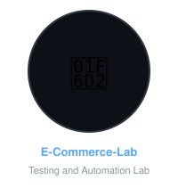
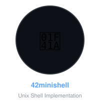
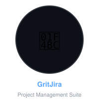
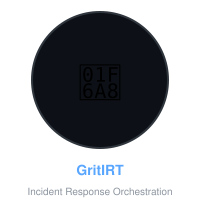
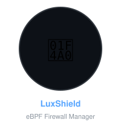

### 👋 Hi, I'm Ahmed
Security-first software engineer

I build tools where security is a design constraint, not a feature.

 

 

 

 

### 🍽️ The Grit ecosystem
One repo, one command, every service — the GritShield product stack, orchestrated by <a href="https://github.com/digiator42/GritSoc">GritSoc</a>.
 

 

 

